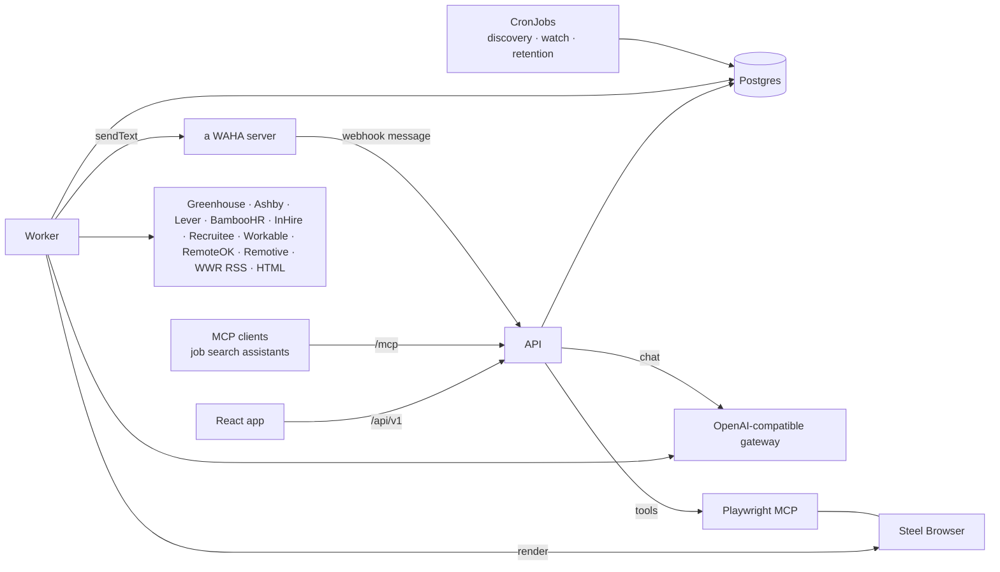
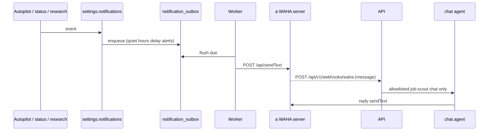

# Architecture

## Processes

| process | entry | role |
|--|--|--|
| **api** | `apps/api/src/index.ts` | Hono REST under `/api/v1`, MCP under `/mcp`, static web bundle in prod. Runs drizzle migrations on boot. Runs the chat agent loop (SSE). `EMBED_WORKER=1` also starts the worker in-process (dev). |
| **worker** | `apps/worker/src/index.ts` | Claims `jobs` rows (`FOR UPDATE SKIP LOCKED`), runs them with bounded concurrency, retries transient LLM/network failures, parks jobs that hit a cap for an hour, requeues stale `running` rows every 15 min and releases in-flight jobs on SIGTERM. Flushes WhatsApp `notification_outbox` (~4s). Inbound chat is a WAHA webhook into the API. In-process scheduler (`WORKER_SCHEDULER=1`) enqueues discovery/watch/retention on timers; in Kubernetes that is off and CronJobs do it. |
| **once** | `apps/worker/src/once.ts <task>` | One-shot `discovery` / `watch` / `retention` for CronJobs (`stale-triage` runs the sweep alone). `watch` also runs the capped stale-triage sweep. |

Both api and worker import `@job-scout/core`; there is no HTTP between them, the database is the queue and the contract. Both serve Prometheus metrics on `:9464/metrics` and log JSON to stdout; the api additionally reports DB-truth gauges (queue depth, funnel, inbox). See [OBSERVABILITY](./OBSERVABILITY.md).

## Job types

| type | enqueued by | does |
|--|--|--|
| `board_scan` | discovery scheduler, Discovery, MCP | fetch a board, diff against the last snapshot, run the gate, upsert positions, enqueue `triage` only when a model key is set |
| `scan_url` | Add URL, MCP `intake` | fetch one JD, create/refresh the position, enqueue `triage` only when a model key is set |
| `watch_check` | watch scheduler, Position › refresh | re-fetch a JD, write a `jd_revisions` row if it changed, detect closed listings |
| `triage` | gate pass, autopilot, stale-triage sweep (watch tick) | cheap 1–5 score + hard disqualifiers; sets `triage_*` on the position |
| `evaluate` | you, autopilot | A–H markdown report + summary JSON → `evaluations` |
| `company_research` | you, autopilot | company dossier → `evaluations(kind=company_research)` |
| `jd_review` | material JD change, you | what changed and whether it matters → `evaluations(kind=jd_review)` |
| `materials` | you, autopilot | tailored resume + cover → `application_materials` |
| `listing_classify` | messy ATS location, you, MCP | tighten geo from the JD. It does not weaken an existing hard block |
| `form_answers` | you, Autopilot preset after evaluate | draft answers on `application_questions`. Nothing is submitted |
| `interview_brief` | a stored transcript, you, MCP | markdown debrief → `interviews.ai_brief_*`. Skipped when no model key is set |
| `retention` | scheduler / CronJob | prune snapshots, jobs, discovery rows, deltas, LLM runs per Settings › System |
| `jev_check` | first JD / material JD change with Jev triage enabled | record a Jev job-fit answer; never changes scores or stages ([JEV](./JEV.md)) |

## Packages

| path | role |
|--|--|
| `packages/shared` | pure code: gate, settings schema + defaults, notify routing/allowlist/quiet hours, classify (craft/geo/remote), salary parsing, hashing, types, the JSON logger (`log.ts`) |
| `packages/db` | drizzle schema, migrations, client (Postgres via `pg`, or PGlite when `DATABASE_URL` is unset); includes `notification_outbox` |
| `packages/ats` | URL detection, board listers (Greenhouse, Ashby, Lever, BambooHR, Remote OK, Remotive, We Work Remotely) and single-posting fetchers (those ATSs plus InHire, Recruitee and Workable through their public posting APIs; others through HTML + JSON-LD). `fetchJobFromUrl(url, { render })` accepts a renderer for JS-only pages. BambooHR reads the public `careers/list` and `careers/{id}/detail` JSON; Ashby liveness and pay come from its posting API. A Lever JD is the description plus every `lists` section (responsibilities, requirements) and the `additional` closing, and Lever's `workplaceType` is carried as the structured workplace. Fetch failures are classified (`fetch-error.ts`: `http_status` `blocked` `timeout` `network` `parse_failed` `unsupported_provider`) |
| `packages/llm` | OpenAI-compatible client: `chatJson` (json_schema with lenient fallback), `chatDocument` (markdown + trailing JSON), `chatStream` (tool calls); prompts as code; the scout brief |
| `packages/core` | everything with a database: positions, companies, scan/watch, triage/evaluate/materials, autopilot hooks, approvals, chat agent, WAHA sender + notify outbox + WhatsApp inbox, browser client, settings, retention, radar; `metrics.ts` is the Prometheus registry every module increments |
| `apps/api` | routes by resource, auth, envelope, MCP server |
| `apps/worker` | job dispatch, retries, scheduler |
| `apps/web` | React 19, TanStack Router/Query, Tailwind 4; `ui/kit.tsx` primitives, `frame/` shell, `pages/` |

## Where things live

| owner | data |
|--|--|
| **Postgres** | positions, JD revisions, evaluations, materials, timeline, interviews, recruiter leads and their outreach log, boards/snapshots/deltas, discovery feed, jobs, LLM runs, Jev decision runs, settings, approvals, chat threads, notification outbox |
| **Settings row** | one JSON document (`settings` table) validated by `packages/shared/src/settings.ts`: gate, triage thresholds, per-operation models, autopilot policy, chat permissions, WhatsApp notifications, retention, scan cadence |
| **WhatsApp** | optional WAHA server. `WAHA_BASE_URL` / `WAHA_SESSION` plus Secret keys `WAHA_API_KEY` and `WAHA_WEBHOOK_KEY`. Outbound = worker `sendText` flush of `notification_outbox`. Inbound = `POST /api/v1/webhooks/waha` (`message` only). Groups are whatever chat ids you save in Settings |
| **External tracker** | optional. Positions can store a link in `positions.metadata.careerOps` |
| **Browser plane** | optional Steel Browser plus a Playwright MCP next to it. job-scout only holds the URLs in env |

## Auth

- **Session** — `POST /api/v1/auth/login` with `AUTH_PASSWORD` sets a signed, expiring cookie. `AUTH_MODE=dev` skips it.
- **Bearer** — A configured `API_TOKEN_SEED` is an admin token (no default exists); further tokens are minted under Settings › System and stored hashed in `api_tokens` with scopes (`agent`, `mcp`, `admin`).
- **`AUTH_MODE=cf_access`** — verifies the Cloudflare Access JWT against the configured issuer and application audience; an email header alone is rejected. See [SECURITY.md](SECURITY.md).

MCP uses the same Bearer tokens.

## WhatsApp path

Policy: `packages/shared/src/notify.ts`. Sender: `packages/core/src/waha.ts`. Outbox: `packages/core/src/notify.ts` (`flushNotify` claims a pending row via `provider_ref` before `sendText` so the API and worker cannot double-send). Inbox: `packages/core/src/whatsapp-inbox.ts` (`handleWahaWebhookEvent`). When configuring WAHA, preserve any other webhooks already attached to the session.

## JD snapshots

Every board scan, watch check, refresh and intake goes through `applySnapshot` (`packages/core/src/positions.ts`). `snapshotBlockReason` refuses a fetched posting before it can replace the stored JD:

| refusal | when | `force` lifts it |
|--|--|--|
| `not_a_jd:<signature>:<where>` | JS wall, loading placeholder, ATS vendor boilerplate or soft-404 page (`packages/shared/src/page-signature.ts`). A text-only "not found" page closes a listing only on a second observation at least 30 minutes later | no |
| `failed_fetch:<why>` | the fetcher flagged the response (for example a job id mismatch) | no |
| `identity_mismatch:<why>` | the posting belongs to another company or ATS job | no |
| `frozen:interview` / `frozen:offer` | the position is at interview or offer; a closed listing still closes | yes |
| `watch_disabled` | an automatic watch on a non-hot position with `watchEnabled: false`; closure still applies | yes |

Refusals are recorded in `metadata.lastAtsFetch`, logged as `jd.snapshot_rejected` and counted as `watch_checks_total{outcome="rejected"}`. A JD too short to score is stored with `metadata.needsJd`; triage, evaluation and research wait for the real one and run when it arrives. Without a hand-set title a retitle is followed and the slug moves (old slugs stay in `metadata.previousSlugs`). Cosmetic churn (whitespace, decoded HTML entities, a location that only gains detail) is not a material change, and an automatic `jd_review` runs at most once a day per position for description edits. Intake refuses careers board and index URLs (`board_index`) and suggests adding the board instead.

## Failure behaviour

- LLM gate errors (operation disabled, no model, cap or budget reached) are not job failures: the job is parked and retried in an hour.
- A provider-wide LLM failure (`auth`, `quota`, `upgrade_required`, `outage`) parks LLM jobs without spending attempts until a call succeeds; see [OBSERVABILITY › LLM outages](./OBSERVABILITY.md#llm-outages).
- Transient AI errors and temporary scan fetch failures retry up to 3 attempts with linear backoff. Blocked, invalid and missing source URLs require inspection.
- Postgres pool errors are logged, not fatal; the client reconnects.
- A worker killed mid-job leaves the row `running`; the next worker requeues it after 30 min, and a graceful shutdown releases it immediately.
